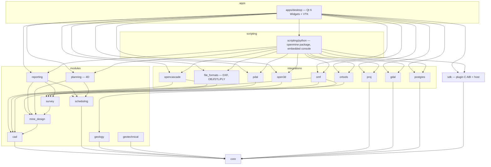

# OpenMine Suite — Architecture

Status: describes the architecture **as implemented in v0.4.0**. What is tested and what is
limited is listed in `IMPLEMENTATION_STATUS.md`; detailed designs are in `docs/architecture/`.

## 1. Principles

1. **One model, one application.** Survey, CAD, mine design, scheduling, geology and
   geotechnical work operate on one in-memory `ProjectModel` (39 entity types), persisted in one
   project container and shown in the same 3D views.
2. **Every change is a command.** All edits go through `ProjectEditor` (validation) and the
   `CommandStack` (undo/redo, macros = one undo step, rollback on failure). Commands publish change
   events and append to an append-only audit log. The desktop, the command console, Python scripts
   and plugins all use the same operations — there is no second way to change the model.
3. **Domain objects, not shapes.** A development heading is a `MineDevelopment` that *references*
   centreline geometry; length, gradient, chainage, section area, volume and tonnes are derived.
4. **Never silently alter engineering data.** Geometry changes *flag* linked schedule activities;
   quantities change only through an explicit, audited recalculation. Baselines and approved design
   revisions are immutable. Survey datasets are never modified: filters, registrations and
   derivations create new datasets or transformation records. CRS transformations are explicit,
   audited operations; declaring a CRS never changes coordinates.
5. **Toolkit-independent core.** `core` and `modules/*` are plain C++20 (+ SQLite, Eigen,
   nanoflann, Clipper2, nlohmann_json). Qt, VTK, Open CASCADE, PDAL, Open3D, PROJ, GDAL, OR-Tools
   and libpq live in `apps` and `integrations`, so the engine is testable headless and scriptable
   from Python. No third-party type appears in a public `core`/`modules` header.
6. **Honest results.** Optional components missing from a build are reported as unavailable (UI
   actions disabled with the reason, Python raises, `openmine.FEATURES` says so). Every format is
   claimed only with a round-trip or import test; results record the method and engine that
   produced them.

## 2. Layering and dependencies



Dashed integrations are optional (`OPENMINE_WITH_*`); a build without one compiles and reports
the feature as unavailable. Arrows point downwards only; there are no cycles.

| Library | Directory | Responsibility | Third-party |
|---|---|---|---|
| `openmine_core` | `core` | objects, geometry, coordinates, commands, project/editor, persistence, assets, jobs, events, diagnostics | SQLite, Eigen, nlohmann_json |
| `openmine_cad` | `modules/cad` | curve primitives and intersections, editing algorithms (offset/trim/extend/fillet/chamfer/split/join/explode), snaps, annotation geometry | — |
| `openmine_mine_design` | `modules/mine_design` | headings and derived metrics, envelopes, layouts (horizontal, decline/spiral/ramp, access, ore drive, crosscuts, vertical alignment), design rules, grading, stopes/blocks, revisions, project-level geometry edits, design ↔ schedule impact | — |
| `openmine_survey` | `modules/survey` | point buffers, octree format, text formats, processing (filters, normals, segmentation, planes, distances), registration (pair/control/ICP), meshing (Delaunay, mesh tools), derivations, as-built pipeline, conformance, face position | Eigen, nanoflann, Clipper2 |
| `openmine_scheduling` | `modules/scheduling` | calendars, calendar-time CPM, levelling, production cycles, periods, scenarios, schedule table | — |
| `openmine_planning` | `modules/planning` | 4D snapshots, playback, scenario comparison | — |
| `openmine_reporting` (+ `_survey_reports`) | `modules/reporting` | own PDF writer, HTML reports, Gantt PDF, XLSX workbooks, survey/conformance/registration reports | zlib, libxlsxwriter |
| `openmine_geology` | `modules/geology` | drillholes, desurveying, compositing, declustering, block models, variography, nearest/IDW/ordinary and simple kriging, cross-validation, grade–tonnage | Eigen, nanoflann |
| `openmine_geotechnical` | `modules/geotechnical` | stereonets (equal-area/angle, density contours), Fisher statistics, joint sets, Terzaghi weighting, kinematic analysis, Q with support, RMR89, GSI, Hoek–Brown | Eigen |
| `openmine_formats` | `integrations/file_formats` | DXF R2004 reader/writer (own), OBJ/STL/PLY meshes | — |
| `openmine_omf` | `integrations/omf` | OMF v1 reader/writer (own) | zlib |
| `openmine_occt` | `integrations/opencascade` | B-rep solids, booleans, sweeps, extrude/revolve/loft, fillet/offset, healing, sections, STEP/IGES | Open CASCADE |
| `openmine_pdal` | `integrations/pdal` | LAS/LAZ/E57/PLY streaming I/O, SMRF ground, Poisson engine | PDAL |
| `openmine_open3d` | `integrations/open3d` | alternative engines: ICP (point-to-point/plane), normals, statistical/radius outliers, voxel, Poisson | Open3D |
| `openmine_crs` | `integrations/proj` | CRS declaration, identification, transformations, local grids | PROJ |
| `openmine_gis` | `integrations/gdal` | DEM raster and vector (SHP/GPKG/GeoJSON/KML) exchange | GDAL |
| `openmine_optimisation` | `integrations/ortools` | CP-SAT resource-constrained sequencing | OR-Tools |
| `openmine_repository` | `integrations/postgres` | multi-user repository with revisions, merges, locks, spatial queries | libpq (server: PostgreSQL + PostGIS) |
| `openmine_plugin_host` | `sdk` | native plugin discovery, loading, ABI host functions | — |
| `openmine` (Python) | `scripting/python` | pybind11 bindings + facade, embedded interpreter for the desktop | pybind11, Python |
| `openmine-desktop` | `apps/desktop` | the application | Qt 6, VTK |

## 3. Core

* **Objects** (`core/include/openmine/objects`): `Uuid` (v4, never changes), `Date`/`DateTime`,
  entity structs grouped by domain (project, CAD, survey, design, schedule, geology), enum names,
  attribute schema. Every entity carries `EntityMetadata {createdAt, modifiedAt, revision}`.
* **Geometry**: `Vec3` (double), polylines with bulges (plan arcs), curves (arc/circle/spline),
  profiles, sweeps, 2D polygons, mesh operations, transforms, local-grid fits. Tolerances are
  explicit: degeneracy 1e-6 m, design-change detection 1 mm, CPM float 0.001 working minutes.
* **Coordinates**: geometry is stored and computed in double-precision project coordinates; only
  the rendered copy is shifted by a render origin (Lo-system X ≈ 2 900 000 m would otherwise lose
  millimetres in 32-bit GPU floats).
* **Commands**: `Command`, `MacroCommand`, `CommandStack` (undo index, clean index, macro scopes
  that roll back on exceptions), entity set commands that snapshot before/after.
* **Project**: `ProjectModel` (`EntityStore<T>` per type, ordered), `Project` (model, command
  stack, event bus, asset store, audit log, file path), `ProjectEditor` (per-type validation,
  deletion policies — restrict, cascade or set-null — attachments follow their entity).
* **Persistence**: `.openmine` SQLite container (schema v2, v1 reader kept for migration), atomic
  verified saves, entity documents (lossless JSON per entity), compaction.
  See [project-format.md](docs/architecture/project-format.md).
* **Assets**: immutable sidecar files/folders with SHA-256 (octrees, B-reps, block-model arrays,
  reports, attachments).
* **Jobs**: `JobRunner` worker pool; long algorithms take `Progress&` and are cancelled
  cooperatively (`CancelledError` at the next progress update).
* **Events**: synchronous `EventBus` (entity kind, id, change type) from the model to observers.

## 4. Application state and threading

```
QApplication
 └─ MainWindow ───────────────────────── owns ── AppContext (QObject)
     ├─ menu bar + Ribbon (10 workspaces)        ├─ unique_ptr<Project> (nullptr = none open)
     ├─ ViewportArea (1 | 2 | 2H | 4 views)       ├─ selection (EntityKind, Uuid)…, current layer
     │   ├─ SceneCache (display items, shared)    ├─ ScenarioSchedule of the active scenario
     │   ├─ PointCloudStore / LOD (per view)       ├─ JobManager (background jobs)
     │   └─ ToolController (CAD tools, snaps)     ├─ PluginManager + Python plugin commands
     ├─ docks: Project Explorer, Properties, Layers, Scheduler (Gantt), Command Console,
     │         Python Console, Jobs, Reports, 4D Playback, Stereonet
     └─ status bar: tool, snaps, CRS, cursor X/Y/Z
```

* `AppContext` subscribes to the project's `EventBus` and re-emits Qt signals (`modelChanged`,
  `selectionChanged`, `scheduleRecalculated`, `undoStackChanged`, `projectReplaced`, `message`).
* **Schedule recalculation is coalesced**: a burst of events (a macro) triggers one
  `calculateScenario` on the next event-loop turn. The scheduler, reports, 4D playback and Python
  all use `calculateScenario`, so one scenario never shows different dates in different places.
* **Background jobs** (`apps/desktop/app/JobManager`): work runs on the worker pool against a
  read-only *snapshot* of the project, so the user can keep working; it returns a function that
  runs on the UI thread to apply its result through `ProjectEditor` / module commit functions (one
  validated undo step). The Jobs panel shows progress, stage text and Cancel; a cancelled job
  applies nothing.
* **Point-cloud display**: per-view level-of-detail selection on the octree (frustum, projected
  spacing, point budget), nodes loaded on worker threads, cached across views.
* **Scene cache**: display items are rebuilt lazily only for the entities a change affects;
  viewports replace only those actors.
* **Selection** is global: viewport picking, the explorer, Gantt rows and the console all set it;
  selecting an activity highlights its linked design objects.

## 5. Domain workflows

### Design ↔ schedule (spec §6.5)

| Step | Implementation |
|---|---|
| Detect geometric changes | `mine_design::detectDesignImpacts` compares current centreline length with the approved length (1 mm) |
| Recalculate quantities | derived on demand (`computeMetrics`: length, gradient, section area, volume, tonnes, loose volume) |
| Identify affected activities | `ActivityDesignLink` (`ProjectModel::activitiesForDevelopment`) |
| Flag impacts | `updateGeometryWithImpact` flags linked activities **in the same undo step** as the edit |
| Controlled recalculation | `applyDesignQuantities` — explicit, audited (`Recalculate`), undoable |
| Preserve baselines | baselines and approved revisions are immutable snapshots |

### Survey

Import (streamed into an octree asset) → derive (new datasets with exact derivation text) →
register (pair/control fits, ICP — stored as `Registration` + transformation, reversible, residual
reports) → surfaces (Delaunay 2.5D, Poisson via PDAL or Open3D) → as-built of a heading → design
conformance (overbreak/underbreak, clearance, face position) → survey actuals reconciled with
reported advance. See [conformance.md](docs/architecture/conformance.md) and
[formats/octree.md](docs/formats/octree.md).

### Scheduling

Calendar-time CPM on shift calendars (activity ∩ resource calendars), rates from cycles and
resource productivity, dated actuals and status-date reforecast, scenarios, heuristic levelling,
OR-Tools optimisation stored as scenarios, periods/targets, 4D. See
[scheduling.md](docs/architecture/scheduling.md).

## 6. Desktop user interface

* **Menus**: File, Edit, View, Draw, Modify, Survey, Mine Design, Scheduler, Geology,
  Geotechnical, Tools (with plugin commands), Window, Settings, Help. **Ribbon**: Home, Survey, CAD, Mine Design, Scheduler, Geology,
  Geotechnical, Analysis, Reporting, Automation. Every ribbon/menu tool is a shared `QAction`; a
  customisable quick-access toolbar stores action ids per user.
* **Viewports** (`apps/desktop/viewport`, `vtk/QtVtkWidget`): VTK hosted in an own
  `QOpenGLWidget` adapter ([ADR 0005](docs/adr/0005-own-qt6-vtk-adapter.md)); perspective/
  parallel; named views; 1/2/4-view layouts; section views; picking; work plane; grid; axis triad;
  render origin; point-cloud LOD; clip planes.
* **CAD tools**: draw (point, line, polyline, polygon, rectangle, circle, 3-point arc, spline,
  text, dimensions, hatch), measure (distance, area), edit (move, copy, rotate, mirror, scale,
  offset, trim, extend, fillet, chamfer, split, join, explode), grips on the selection (vertices;
  arc/circle centre, radius and ends — click a grip, then the new position or typed coordinates),
  window/crossing box selection and multi-selection,
  object snaps (endpoint, midpoint, centre, intersection, perpendicular, tangent, nearest, node,
  grid, surface), ortho, typed input (`x,y,z`, `@dx,dy,dz`) while a tool runs.
* **Panels**: Project Explorer (all entity categories, context actions), Properties (typed
  editors, validated, undoable; derived values read-only; schema-driven attributes), Layers,
  Scheduler (WBS grid + custom-painted Gantt, dependency arrows, critical path, baseline bars,
  progress, impact markers, status line, resource histogram, production charts), Command Console,
  Python Console, Jobs, Reports (HTML preview, PDF/XLSX export), 4D Playback, Stereonet.
* **Command console**: 97 commands with aliases, history and typed point syntax; the reference
  ([docs/console-commands.md](docs/console-commands.md)) is generated from the registry and
  checked by `ctest -L docs`.
* **Themes**: original dark and light palettes; all icons are drawn programmatically (no
  third-party icon sets).

## 7. Python

`openmine._core` (pybind11) exposes validated native operations; `openmine` provides the public
facade (`Project` with `documents`, `cad`, `solids`, `design`, `scheduler`, `survey`, `geology`,
`geotech`, `formats`, `crs`, `reports`, `attachments`), wrapper objects (`Development`,
`Activity`, `PointCloud`, `ScheduleResult`), modules (`survey`, `geology`, `geotech`, `formats`,
`plugins`, `repository`) and named exceptions. Long native calls release the GIL and accept a
`Progress` for cancellation. The desktop embeds the same package (`scripting/python/embed`): an
interactive console and script runner on the live project. Guide: [docs/python.md](docs/python.md);
reference generated and checked: [docs/reference/python-api.md](docs/reference/python-api.md).

## 8. Plugins

Native plugins use a stable C ABI (`sdk/include/openmine_plugin.h`, API v1): commands, importers
and exporters; model access only through validated entity documents grouped into undo steps; the
host rolls back open edits and catches exceptions at the boundary. Python plugins register commands
through the `openmine.plugins` entry-point group. See [docs/plugins.md](docs/plugins.md).

## 9. Shared repository

`integrations/postgres` stores projects as revisions of entity documents in PostgreSQL with
PostGIS geometry for spatial queries; desktop users check out working copies (`.openmine` files),
pull with an explicit conflict policy and publish new revisions; advisory locks reserve entities.

## 10. Build

CMake ≥ 3.25 with presets; C++20. Options: `OPENMINE_BUILD_APP`, `OPENMINE_BUILD_TESTS`,
`OPENMINE_BUILD_PYTHON`, `OPENMINE_WARNINGS_AS_ERRORS` and `OPENMINE_WITH_{OCCT,PROJ,GDAL,ORTOOLS,
PDAL,OPEN3D,POSTGRES}`. A single version (`project(VERSION)`) is generated into
`openmine/Version.h` and the Python package. See `DEVELOPMENT.md`.

## 11. Technical risks

| Risk | Impact | Mitigation |
|---|---|---|
| Large coordinates in float GPU pipelines | jitter, mis-picks | render origin; doubles everywhere in the model; octree stores float64 coordinates |
| Point clouds of 10⁸–10⁹ points | memory, UI stalls | out-of-core octree, streamed import, LOD with point budget, background jobs |
| OCCT robustness on mesh-derived solids | failed booleans | `BRepCheck` validation, healing, results labelled invalid rather than used |
| Poisson surfaces invent geometry over gaps | false overbreak | trimming to the scan, partial sections excluded, method recorded |
| DWG support | licensing | LibreDWG is GPL-3 (incompatible in-process); DXF only, ODA as a possible separate plugin |
| Proprietary formats (Deswik/Maptek) | legal | only documented open formats (DXF, CSV, OMF, LAS/LAZ, E57, PLY, OBJ, STL, STEP/IGES, GeoTIFF, GPKG, SHP, GeoJSON, KML) |
| LGPL/EPL/GPL obligations of dependencies | compliance | dynamic linking; GDAL built without GPL drivers for distribution; see `docs/licensing.md` |
| SQLite files on network shares | corruption | atomic save + `.bak`; PostgreSQL repository for teams |
| Windows target not exercised locally | platform bugs | CI job on Windows (MSVC + vcpkg); see `IMPLEMENTATION_STATUS.md` |
