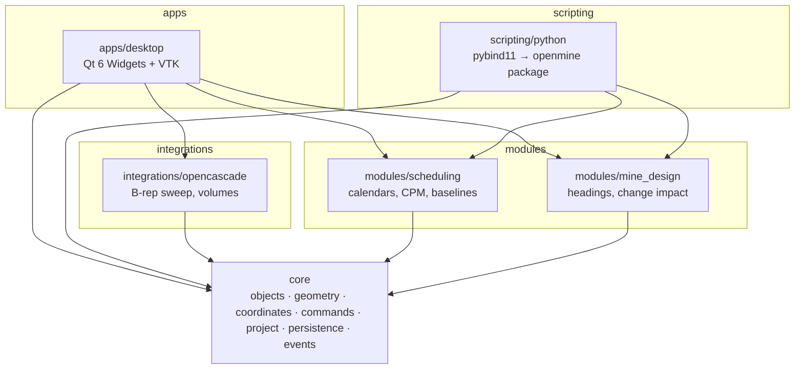
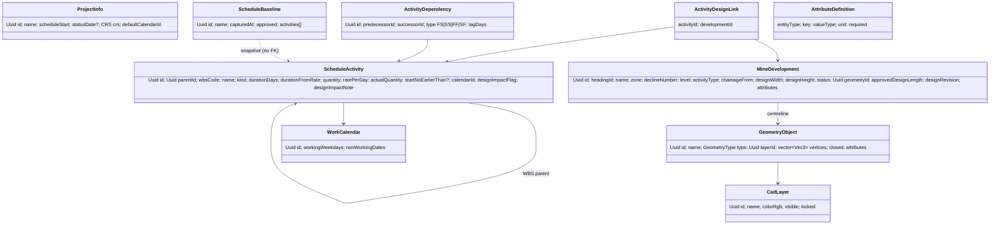

# OpenMine Suite — Architecture

Status: describes the architecture **as implemented in v0.1.0** and the planned extension points.
Anything marked *planned* does not exist in code yet; see `IMPLEMENTATION_STATUS.md`.

## 1. Principles

1. **One model, one application.** Survey, CAD, mine design and scheduling operate on a single
   in-memory `ProjectModel`, persisted in one project container, shown in one 3D viewport.
2. **Every change is a command.** All edits go through `ProjectEditor`, which validates and
   executes undoable `Command`s. Commands publish change events and append to an append-only
   audit log. Nothing edits the model behind the undo stack.
3. **Domain objects, not shapes.** A development heading is a `MineDevelopment` that *references*
   centreline geometry; length, chainage-to and gradient are derived, never typed in.
4. **Never silently alter engineering data.** Geometry changes *flag* linked schedule activities;
   quantities change only through an explicit, audited recalculation. Baselines are immutable.
   CRS is declared, never inferred.
5. **Toolkit-independent core.** `core` and `modules/*` are plain C++20 + SQLite. Qt, VTK and
   OCCT live at the edges (apps, integrations), so the engine is testable headless and
   scriptable from Python.
6. **Honest UI.** Planned tools are visible but disabled with a "planned: Phase N" tooltip;
   planned console commands say they are unavailable.

## 2. Layering and module dependencies



Rules: arrows point only downwards; `modules/*` never depend on each other except through
`core` (mine_design does not link scheduling — it edits `ScheduleActivity` entities, which are
core data); no Qt/VTK/OCCT types in public `core`/`modules` headers.

| Layer | Directory | Responsibility | External deps |
|---|---|---|---|
| Objects | `core/include/openmine/objects` | `Uuid`, `Date`, entity structs, attribute schema | — |
| Geometry | `core/.../geometry` | `Vec3`, polyline metrics with explicit tolerances | — |
| Coordinates | `core/.../coordinates` | render origin for large coordinates (CRS transforms planned via PROJ) | — |
| Commands | `core/.../commands` | `Command`, `MacroCommand`, `CommandStack`, snapshot entity commands | — |
| Project | `core/.../project` | `Project`, `ProjectModel`, `EntityStore`, `ProjectEditor` (validated edits) | — |
| Persistence | `core/.../persistence` | `.openmine` SQLite container, migrations, atomic save, integrity checks | SQLite |
| Events | `core/.../events` | synchronous `EventBus` (model → observers) | — |
| Scheduling | `modules/scheduling` | `WorkingTime` calendar mapping, CPM, baseline snapshots | core |
| Mine design | `modules/mine_design` | heading creation, metrics, geometry→schedule impact workflow | core |
| OCCT adapter | `integrations/opencascade` | swept solids, B-rep length/volume/area | OCCT |
| Desktop | `apps/desktop` | Qt shell, ribbon, docks, VTK viewport, Gantt, console | Qt 6, VTK 9 (Qt 6 build) |
| Python | `scripting/python` | `openmine` package (facade) over `openmine._core` | pybind11 |

Planned directories (`modules/survey`, `modules/cad`, `modules/geology`, `modules/geotechnical`,
`modules/reporting`, `integrations/pdal|open3d|vtk|database|file_formats`, `plugins/`) contain a
README stating their planned scope only.

## 3. Application state model

```
QApplication
 └─ MainWindow ─────────────── owns ─── AppContext (QObject)
     ├─ Ribbon (QTabWidget)               ├─ unique_ptr<Project>  (nullptr = no project)
     ├─ Viewport3D (central)              │    ├─ ProjectModel      (all entities)
     ├─ ProjectExplorer (dock)            │    ├─ CommandStack      (undo/redo, clean index)
     ├─ PropertiesPanel (dock)            │    └─ EventBus          (ChangeEvent)
     ├─ SchedulerPanel (dock)             ├─ Selection {EntityKind, Uuid}
     └─ CommandConsole (dock)             └─ ScheduleResult (latest CPM)
```

* `AppContext` subscribes to the project's `EventBus` and re-emits Qt signals
  (`modelChanged`, `selectionChanged`, `scheduleRecalculated`, `undoStackChanged`,
  `projectReplaced`, `message`).
* CPM recalculation is **coalesced**: a burst of events (e.g. a macro) triggers one CPM run on the
  next event-loop turn. CPM is O(V+E) and runs in microseconds for realistic schedules; background
  workers are reserved for point clouds and solid modelling (planned).
* Panels rebuild lazily (also coalesced). The viewport keeps a map `vtkActor* → Selection` for
  picking.
* Selection is global: picking in the viewport, clicking in the explorer or a Gantt row all set
  `AppContext::selection`, and selecting an activity highlights its linked design in 3D.

### Project lifecycle

`New → (edits: commands) → Save (atomic) → Close → Open (verify → read → clean stack)`.
`isModified()` is "undo index ≠ clean index"; saving marks clean.

## 4. Geometry and object model



* All persistent entities carry a v4 UUID that never changes (stable across undo/redo/save/load).
* Every entity has `EntityMetadata {createdAt, modifiedAt, revision}`; `revision` increments on
  each committed modification.
* Geometry is stored in **double precision project coordinates** (metres). Tolerances: change
  detection 1 mm (`mine_design::kDesignChangeTolerance`), degeneracy 1e-6 m
  (`geometry::kLengthTolerance`), CPM float 1e-6 working days.
* Custom attributes are schema-driven (`AttributeDefinition`), validated on every edit and
  persisted per entity.
* Entities from the specification not yet implemented (`SurveyControlPoint`, `PointCloudDataset`,
  `Registration`, `MineLevel`, `Decline`, `Stope`, `GeologicalObject`, `Resource`,
  `ResourceCalendar`, `ActivityResourceAssignment`, `ProductionActual`, `DesignRevision`,
  `AnalysisResult`, `Attachment`) are specified in `docs/architecture/database-schema.md` as the
  planned v2+ schema.

## 5. Persistence

See `docs/architecture/project-format.md` and `docs/architecture/database-schema.md`.
Summary: a `.openmine` file is an SQLite database (`application_id = 'OMIN'`,
`user_version = schema version`) with explicit FKs, CHECK constraints and indices; large binaries
go in a sidecar `<file>-assets/` folder referenced by relative path + SHA-256. Saves are atomic
(temp file → `integrity_check` + `foreign_key_check` → rename; previous file kept as `.bak`).
Older schemas are migrated in a temporary copy; newer schemas are refused.

## 6. Scheduling engine

See `docs/architecture/scheduling.md`. CPM supports FS/SS/FF/SF with positive/negative lags,
start-no-earlier-than constraints, milestones, WBS roll-up, total/free float, critical path,
rate-driven durations and remaining-work reforecast from a status date. It is validated against a
hand-calculated reference network. Resource-constrained optimisation (OR-Tools) will be a
separate layer that never overwrites CPM results.

## 7. Geometry-linked scheduling (spec §6.5)

| Step | Implementation |
|---|---|
| 1 Detect geometric changes | `mine_design::detectDesignImpacts` compares current centreline length with `approvedDesignLength` (1 mm tolerance) |
| 2 Recalculate quantities | computed on demand (`computeMetrics`) |
| 3 Identify affected activities | `ProjectModel::activitiesForDevelopment` |
| 4 Flag schedule impacts | `updateGeometryWithImpact` sets `designImpactFlag` + note **in the same undo step** as the edit |
| 5 Controlled recalculation | `applyDesignQuantities` (explicit user action) |
| 6 Preserve baseline | baselines are snapshots; nothing writes to them after capture |
| 7 Audit | every step appends audit entries; recalculation adds a `Recalculate` entry |

## 8. UI component design

* **Ribbon** (`apps/desktop/ribbon`): 10 workspaces — Home, Survey, CAD, Mine Design, Scheduler,
  Geology, Geotechnical, Analysis, Reporting, Automation. Real tools are `QAction`s shared with
  menus and shortcuts; planned tools are disabled buttons with tooltips.
* **Viewport3D** (`apps/desktop/viewport`): `QVTKOpenGLNativeWidget`; perspective/parallel; top,
  front, side, iso; fit; picking via `vtkCellPicker`; draw line/polyline on a horizontal work plane
  with grid snap and endpoint (object) snap; rubber band; axis triad; adaptive grid; translucent
  excavation envelopes; green actual-advance overlay; warning colour for flagged headings; render
  origin for large coordinates.
* **ProjectExplorer**: tree of all spec categories; unavailable categories greyed with tooltip;
  layer check boxes toggle visibility through undoable commands.
* **PropertiesPanel**: typed editors (text, number, bool, choice, date); all edits validated and
  committed as commands; derived values read-only; custom attributes shown from the schema.
* **SchedulerPanel**: WBS tree grid + custom-painted Gantt (no Qt Charts — GPL-only), dependency
  arrows, critical path, baseline bars, progress, design-impact markers, status-date line,
  calendar-aware shading, zoom, CSV export.
* **CommandConsole**: registry of named commands with aliases, history, point syntax
  `x,y,z | x,y | @dx,dy,dz`; planned commands registered as unavailable.
* **Themes**: original dark (default) and light palettes; icons are drawn programmatically.

## 9. Python API boundary

`openmine._core` (pybind11) exposes validated native operations; `openmine/__init__.py` provides
the public facade (`Project`, `project.cad`, `project.scheduler`, `project.survey`). Unbuilt
features raise `NotImplementedError`. Errors map to `openmine.ValidationError` (ValueError) and
`openmine.PersistenceError` (OSError).

## 10. Plugin architecture (planned, Phase 6)

Plugins will be shared libraries exporting a C ABI entry point
(`openmine_plugin_v1(const OpenMineHostV1*)`) that registers ribbon actions, console commands and
importers against versioned host interfaces, plus pure-Python plugins using the `openmine`
package. The console registry and ribbon groups are already the extension seams. See
`plugins/README.md`.

## 11. Build strategy

CMake ≥ 3.25 with presets. Linux dev builds use distro packages (Qt 6.4, OCCT 7.6, SQLite,
GoogleTest) plus **VTK 9.3 built against Qt 6** (distro VTK is linked to Qt 5). Windows builds use
MSVC + vcpkg manifest (`vcpkg.json`, `vtk[qt]` is built with Qt 6). Options:
`OPENMINE_BUILD_APP`, `OPENMINE_BUILD_TESTS`, `OPENMINE_BUILD_PYTHON`, `OPENMINE_WITH_OCCT`.
See `DEVELOPMENT.md`.

## 12. Technical risks

| Risk | Impact | Mitigation |
|---|---|---|
| Qt 5/6 mix via distro VTK | build break | build VTK against Qt 6 (done); vcpkg on Windows |
| Large coordinates in float GPU pipelines | jitter, mis-picks | render origin; doubles in model (done) |
| Point clouds of 10⁸–10⁹ points | memory, UI stalls | out-of-core octree tiles in asset sidecar, background workers (planned Phase 3) |
| OCCT boolean robustness on mesh-derived solids | failed overbreak calcs | validate solids (`BRepCheck`), fall back to mesh-based signed-volume methods, test datasets |
| DWG support | licensing | LibreDWG is GPL-3 (incompatible with Apache distribution in-process); use ODA under licence as optional plugin, or DXF only |
| Proprietary formats (Deswik/Maptek) | legal, accuracy | only documented open exchange formats (DXF, CSV, OMF, LAS/E57) |
| Schedule calendar semantics | wrong dates | single project calendar in v0.1 with a warning; per-activity calendars require calendar-time CPM (planned) |
| LGPL obligations (Qt, OCCT) | compliance | dynamic linking, relinkable distribution, notices (see licence audit) |
| Single-file SQLite on network shares | corruption | atomic save + `.bak`; enterprise mode via PostgreSQL/PostGIS (planned) |
