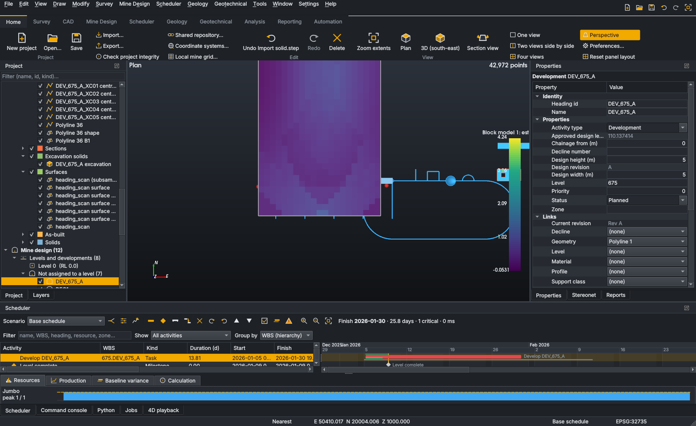

# OpenMine Suite

**Open-source, integrated mine survey, CAD/mine design and scheduling — one application, one
project, one model.**

OpenMine Suite is an original desktop application (C++20 · Qt 6 · VTK · Open CASCADE · PDAL ·
Open3D · PROJ · GDAL · OR-Tools · SQLite/PostgreSQL · Python) that covers, in one shared
environment, the workflow mining teams currently spread across point-cloud survey tools, mine CAD
and mine schedulers:

> survey scan → registration → as-built → design → attributes → schedule activities → resources →
> schedule → actuals → reconciliation → reforecast → reports

It is pre-1.0 (v0.4.0). **What works, with the test that proves it, is listed in
[`IMPLEMENTATION_STATUS.md`](IMPLEMENTATION_STATUS.md)**; what is not done is listed there too.
Optional components missing from a build are shown as unavailable with the reason — nothing
pretends to work.



## What it does

* **Survey** — LAS/LAZ/E57/PLY/XYZ/PTS/PTX import into an out-of-core octree; filters,
  normals, segmentation and ground classification as *derived* datasets (scans are never
  modified); point-pair, control and ICP registration with residual reports; Delaunay and Poisson
  surfaces; volumes; as-built surfaces and design conformance (overbreak/underbreak, clearance,
  face position); CRS transformations and local mine grids.
* **CAD** — the usual drawing, snapping and editing tools including grips, offset/trim/extend/
  fillet/chamfer, dimensions and hatches; Open CASCADE solids (extrude, revolve, sweep, loft,
  booleans, fillet, offset, healing); DXF, OBJ/PLY/STL, STEP/IGES, OMF, GIS formats.
* **Mine design** — declines, ramps, alignments, ore and access drives, crosscuts; development
  headings with derived quantities; design rules and gradient profiles; levels, stopes, mining
  blocks; approved design revisions.
* **Scheduling** — calendar-time CPM on shift and resource calendars, rates from development
  cycles, dated actuals and status-date reforecasts, baselines, scenarios, levelling and OR-Tools
  optimisation, production against targets, 4D playback; Gantt, XLSX and PDF.
* **Integration** — design changes *flag* linked activities instead of silently changing them;
  survey face positions reconcile reported advance; one undo stack and audit log for everything.
* **Geology and geotechnical** — drillholes, compositing, block models, variography and
  kriging; stereonets, joint sets, kinematic analysis, Q, RMR89, GSI, Hoek–Brown.
* **Automation** — a 97-command console, a Python API (`from openmine import Project`) and an
  embedded Python console, native (C ABI) and Python plugins, a PostgreSQL/PostGIS shared
  repository.

## Install (Windows 10/11, 64-bit)

Download `OpenMine-Suite-<version>-Setup.exe` from the
[Releases](https://github.com/lotterinng/openmine-suite/releases) page and run it. It installs for
the current user or, if you choose, for all users; it adds a Start-menu entry, optionally a desktop
icon and the `.openmine` file association. Uninstall from *Settings → Apps*. The Windows build does
not yet include the Python API and console, Open3D engines or the OR-Tools optimiser (the
application says so where they would be used); the Ubuntu package has them.

## Install (Ubuntu 24.04)

Download `openmine-suite_<version>_amd64.deb` and install it — double-click it in the Files app, or:

```bash
sudo apt install ./openmine-suite_0.4.0_amd64.deb
```

Then start **OpenMine Suite** from the applications menu, or run `openmine-suite` (optionally with a
`.openmine` file). Python scripts: `openmine-python script.py`. Remove with
`sudo apt remove openmine-suite`. The package bundles PDAL, Open3D, OR-Tools and Clipper2 under
`/opt/openmine-suite`; everything else comes from Ubuntu packages, which apt installs automatically.

## Build from source (Linux)

See [`DEVELOPMENT.md`](DEVELOPMENT.md) for dependencies and Windows (MSVC + vcpkg).

```bash
cmake --preset linux-debug -DCMAKE_PREFIX_PATH="/opt/pdal;/opt/clipper2;/opt/ortools" \
      -DOpen3D_DIR=/opt/open3d-devel-linux-x86_64-cxx11-abi-0.18.0/lib/cmake/Open3D
cmake --build --preset linux-debug
ctest --preset linux-debug
./build/linux-debug/bin/openmine-desktop
```

Console:

```
POLYLINE -25000,2900000,1200 @-90,0,-11.25 @0,-60,-7.5
HEADING LEG2_675_D3_DEC 5.5 5.5 675
ACTIVITY 5
SAVE /data/Jupiter.openmine
```

Python:

```python
from openmine import Project
project = Project.new("Jupiter Mine", start="2026-11-02")
design = project.cad.create_development(name="LEG2_675_D3_DEC", length=150, width=5.5, height=5.5,
                                        start=(-25000, 2900000, 1200), azimuth_deg=270, gradient_percent=-12.5)
activity = project.scheduler.create_activity(name="Develop LEG2_675_D3_DEC", geometry=design, production_rate=5.0)
scan = project.survey.import_pointcloud("scan.laz").remove_outliers()
report = project.survey.compare_design(design, scan)
project.save("JUP_Mine.openmine")
```

## Documentation

| Document | Contents |
|---|---|
| [docs/user-guide.md](docs/user-guide.md) | the desktop application, workflow by workflow |
| [docs/python.md](docs/python.md) · [docs/reference/python-api.md](docs/reference/python-api.md) | Python guide (examples run as tests) and generated API reference |
| [docs/console-commands.md](docs/console-commands.md) | command console reference (generated) |
| [docs/plugins.md](docs/plugins.md) | native C ABI and Python plugins |
| [ARCHITECTURE.md](ARCHITECTURE.md) | layers, state model, threading, UI, risks |
| [docs/architecture/](docs/architecture/index.md) | scheduling engine, conformance, project format, database schema, coordinates |
| [docs/reference/project-schema.md](docs/reference/project-schema.md) | project file schema (generated) |
| [docs/formats/octree.md](docs/formats/octree.md) | point-cloud octree format |
| [docs/adr/](docs/adr/index.md) | architecture decision records |
| [docs/licensing.md](docs/licensing.md) · [THIRD_PARTY_NOTICES.md](THIRD_PARTY_NOTICES.md) | licence audit and notices |
| [ROADMAP.md](ROADMAP.md) · [IMPLEMENTATION_STATUS.md](IMPLEMENTATION_STATUS.md) | plan and status |
| [DEVELOPMENT.md](DEVELOPMENT.md) · [CONTRIBUTING.md](CONTRIBUTING.md) · [SECURITY.md](SECURITY.md) · [CODE_OF_CONDUCT.md](CODE_OF_CONDUCT.md) | working on OpenMine |

`python3 docs/tools/build_site.py` builds the documentation site (MkDocs) and `doxygen Doxyfile` the C++ API reference; both are checked by `ctest -L docs`.

## Licence

Apache-2.0 (see [`LICENSE`](LICENSE), [`NOTICE`](NOTICE), [`THIRD_PARTY_NOTICES.md`](THIRD_PARTY_NOTICES.md)).
OpenMine Suite is independent and not affiliated with Maptek or Deswik; it does not use their
code, assets or proprietary file formats.
