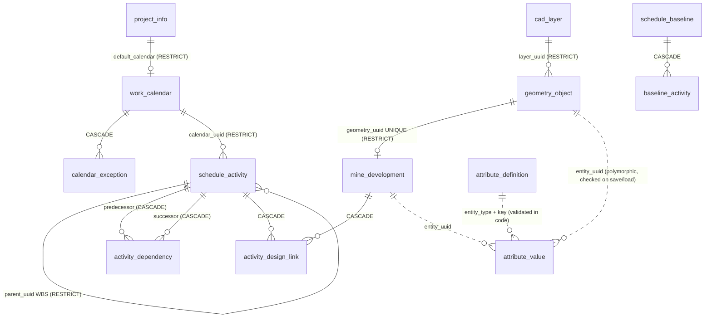

# Database schema and ERD

The authoritative DDL is `kSchemaV1` in `core/src/persistence/ProjectFile.cpp`
(also returned by `openmine::persistence::schemaSql()`).

## Implemented schema (version 1)

| Table | Primary key | Notable constraints / indices |
|---|---|---|
| `schema_migrations` | `version` | one row per applied migration |
| `project_info` | `id = 1` | `linear_unit = 'metre'`; CRS columns are user-declared |
| `cad_layer` | `uuid` | `name UNIQUE` |
| `geometry_object` | `uuid` | type CHECK; `length(vertices) = vertex_count*24`; `ix_geometry_layer` |
| `attribute_definition` | `uuid` | `UNIQUE(entity_type, key)`; value_type CHECK |
| `attribute_value` | `(entity_uuid, key)` | polymorphic; orphan check in `verify()` |
| `work_calendar` | `uuid` | weekday mask 1–127; hours 0–24 |
| `calendar_exception` | `(calendar_uuid, date)` | CASCADE |
| `mine_development` | `uuid` | `heading_id UNIQUE`, `geometry_uuid UNIQUE`, width/height > 0 |
| `schedule_activity` | `uuid` | kind CHECK; duration ≥ 0; `ix_activity_parent` |
| `activity_dependency` | `uuid` | `UNIQUE(pred, succ)`, `pred <> succ`, type CHECK; `ix_dependency_successor` |
| `activity_design_link` | `(activity_uuid, development_uuid)` | CASCADE both sides; `ix_link_development` |
| `schedule_baseline` | `uuid` | `name UNIQUE` |
| `baseline_activity` | `(baseline_uuid, activity_uuid)` | **no FK to activity** — baselines outlive deleted activities |
| `asset` | `uuid` | `relative_path UNIQUE`, SHA-256, size (sidecar binaries; unused until Phase 3) |
| `audit_log` | `seq AUTOINCREMENT` | append-only |

### Deletion policies

| Parent → child | Policy | Enforced in |
|---|---|---|
| layer → geometry | RESTRICT | SQL FK + `ProjectEditor` |
| geometry → development | RESTRICT ("delete the heading first") | SQL FK + `ProjectEditor::removeGeometry` |
| development → links | CASCADE | SQL + `removeDevelopment` macro (undoable) |
| activity → dependencies, links | CASCADE | SQL + `removeActivity` macro (undoable) |
| activity → WBS children | RESTRICT | SQL + `removeActivity` |
| baseline → baseline rows | CASCADE | SQL |
| activity → baseline rows | none (snapshot) | by design |

### Transaction boundaries

* **In memory:** one user action = one `Command` (or `MacroCommand`) = one undo step. Macros
  roll back already-executed children if any child throws.
* **On disk:** one save = one SQLite transaction writing a fresh database file with
  `defer_foreign_keys = ON`, verified, then atomically renamed into place.

### Audit requirements

`audit_log` records timestamp (UTC), OS user, action (`Create|Modify|Delete|Link|Unlink|Undo|Redo|
Recalculate|Cancel|Migrate`), entity type, entity UUID and a human-readable detail. It is
append-only: undo adds an entry rather than removing one.

### Migrations

`kMigrations[]` is an ordered list; entry *n* upgrades schema *n-1 → n* inside a transaction and
records itself in `schema_migrations`. Loading an older file migrates a temporary copy;
the user's file is only rewritten on the next save. Loading a newer schema is refused.

## Planned schema (v2+), from the master specification

| Entity | Key relationships | Phase |
|---|---|---|
| `coordinate_reference_system` | project → CRS; transformation metadata (PROJ pipeline, grid files) | 3 |
| `survey_control_point` | CRS; observation metadata, accuracy class | 3 |
| `point_cloud_dataset` | `asset` (tiles in sidecar), CRS, acquisition metadata | 3 |
| `registration` | point_cloud_dataset → transform, residuals, method (pair/control/ICP) | 3 |
| `as_built_geometry` | registration → mesh `asset` | 6 |
| `design_conformance_result` | as_built × mine_development, over/underbreak, sections | 6 |
| `mine_level`, `decline`, `stope` | typed design objects referencing geometry | 6 |
| `geological_object` | surfaces, solids, drillholes | 6 |
| `resource`, `resource_calendar`, `activity_resource_assignment` | resources ↔ activities | 6 |
| `production_actual` | dated actuals per development/activity (replaces scalar actual quantity) | 5 |
| `design_revision` | development revisions with geometry snapshots | 5 |
| `analysis_result`, `attachment` | generic results/files via `asset` | 6 |

PostgreSQL/PostGIS: the same logical schema with `uuid`, `geometry(LineStringZ, srid)` and
`timestamptz` types, row-level audit triggers and optimistic locking by `revision`. The
`ProjectModel` ↔ storage boundary (`saveProject`/`loadProject`) is where a `ProjectRepository`
interface will be introduced for the enterprise backend.
