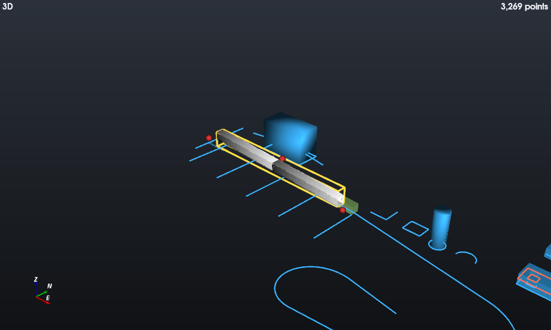
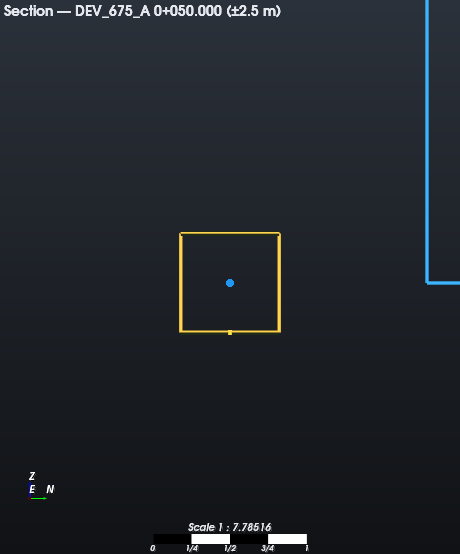
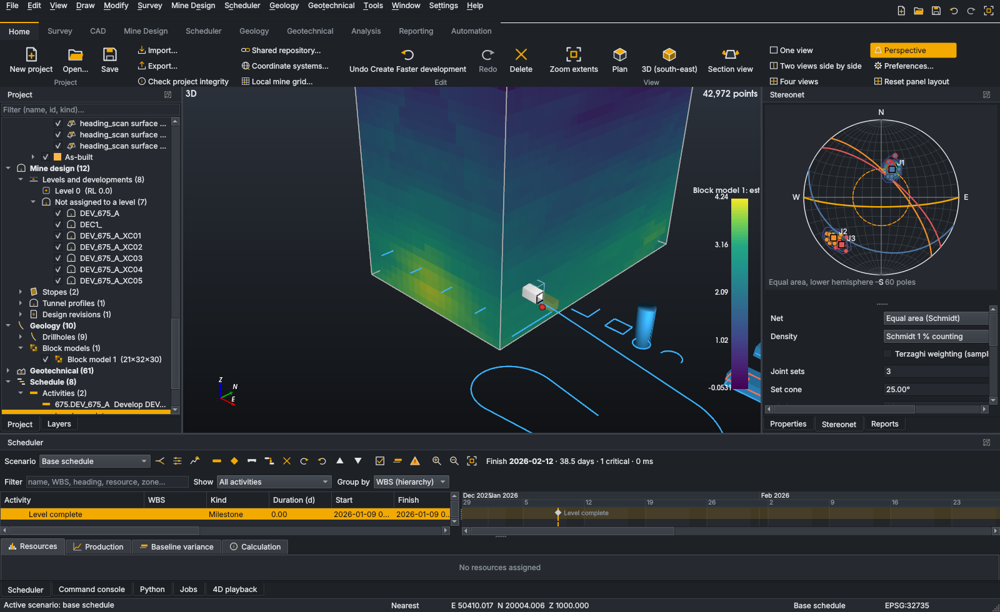
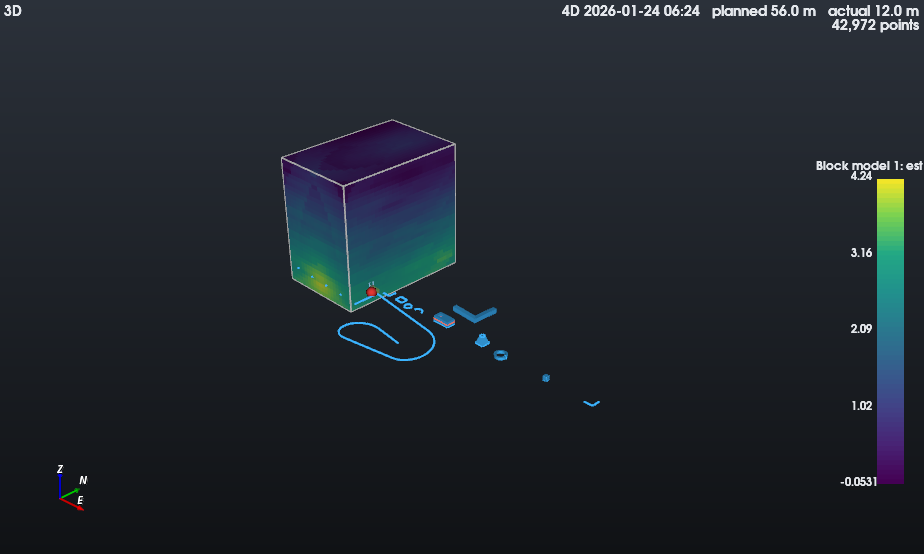
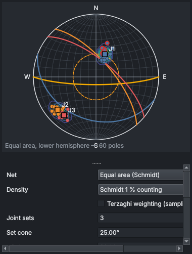

# Desktop user guide

This guide follows the workflow OpenMine Suite is built for —
**scan → register → as-built → design → schedule → actuals → reconcile → reforecast → report** —
using the menu and ribbon names of the application. Every step can also be done from the command
console ([console-commands.md](console-commands.md)) or Python ([python.md](python.md)).

## 1. The window

| Area | Use |
|---|---|
| Menu bar | File, Edit, View, Draw, Modify, Survey, Mine Design, Scheduler, Geology, Geotechnical, Tools, Window, Settings, Help |
| Ribbon | the same tools grouped by workspace: Home, Survey, CAD, Mine Design, Scheduler, Geology, Geotechnical, Analysis, Reporting, Automation |
| Quick-access toolbar | top right; Settings ▸ Customise quick-access toolbar… |
| Project Explorer (left) | every object by category; check boxes show/hide; right-click for the object's actions |
| Viewports (centre) | View ▸ One view / Two views side by side / Four views; the active view has a highlighted frame |
| Properties (right) | the selected object's values: edits are validated and undoable; grey values are derived |
| Scheduler, Command console, Python, Jobs, 4D playback (bottom) | Window ▸ Panels |
| Status bar | active tool and snap, cursor X/Y/Z, active scenario, project CRS |

**Mouse:** left-drag orbits about the point under the cursor (in plan and section views it
draws a selection box), middle-drag or Shift+left-drag pans, the wheel zooms at the cursor,
right-drag zooms, a click selects (Ctrl toggles, Shift adds). A box dragged left→right selects
objects entirely inside it, right→left everything it crosses. `F` zooms to the selection; Escape
ends a tool or clears the selection.

**Undo:** every change — including imports, Python scripts and plugin commands — is one step of
Edit ▸ Undo/Redo, and is recorded in the project's audit log.

## 2. Projects

* File ▸ New project asks for a name and the schedule start date. New projects contain the
  calendars *Standard 5-day*, *Continuous 7-day* and *2 × 10 h shifts, 7 days*, two layers and
  waste/ore materials.
* Tools ▸ Coordinate systems… declares the project CRS (e.g. `EPSG:2051` for Lo25). Declaring a CRS
  never changes coordinates; transforming objects to another CRS is a separate, audited action
  (Tools ▸ Transform objects to another CRS…). Tools ▸ Local mine grid… fits a Helmert or affine
  local grid from control pairs.
* File ▸ Save writes `<name>.openmine` and the folder `<name>.openmine-assets` (point clouds,
  solids, reports, attachments). Keep them together. The previous version is kept as `.bak`.
* File ▸ Check project integrity verifies the file, references and every stored file's SHA-256.
* File ▸ Compact project… removes stored files nothing uses any more (deleted point clouds or
  attachments); it saves the project and clears the undo history, after asking.
* Right-click any object ▸ Attach file… keeps a copy of a photo, field sheet or report with it;
  open or save it from the attachment's context menu.
* File ▸ Shared repository… publishes to and checks out from a PostgreSQL/PostGIS repository
  for teams (see [architecture/project-format.md](architecture/project-format.md)).

## 3. Survey

1. **Import** — Survey ▸ Import point cloud… (LAS, LAZ, E57, PLY, XYZ/CSV/TXT, PTS, PTX). The cloud
   is converted to an out-of-core octree in the background (Jobs panel: progress and Cancel) and
   streams into the views with a point budget (Settings ▸ Preferences ▸ Point clouds).
   Survey ▸ Import control points… reads surveyed control (CSV).
2. **Clean and derive** — Survey ▸ Subsample… / Remove outliers… / Estimate normals… / Classify
   ground… / Crop by polygon / Crop by box… / Segment into clusters… / Extract planes…. Each creates a
   **new dataset** under the original, named with exactly what was done
   ("statistical outlier removal k=16 n=2.000000"). The original scan is never changed. Most
   filters can use the built-in engine or Open3D.
3. **Register** — Survey ▸ Register (pairs / control)… fits a transformation from picked point
   pairs or control points and reports residuals per pair; Survey ▸ Register (ICP)… refines against
   a reference scan (point-to-plane or point-to-point). A registration is stored with the dataset
   (the points are not rewritten) and can be reverted from the explorer.
4. **Surfaces** — Survey ▸ Surface (Delaunay)… for 2.5D ground surfaces, Survey ▸ Surface
   (Poisson)… for closed shapes (PDAL or Open3D engine); Survey ▸ Surfaces ▸ Decimate / Smooth /
   Repair / Compare; Survey ▸ Volume… between a surface and an elevation or another surface;
   Survey ▸ Distance to reference… colours a cloud or mesh by distance.
5. **Reports** — Survey ▸ Point-cloud report and the registration report (explorer) render to HTML
   and PDF in the Reports panel.

## 4. CAD

* Draw ▸ Point, Line, Polyline (C closes, Backspace removes the last point, Enter/right-click
  finishes), Polygon, Rectangle, Circle, Arc, Spline, Text, Dimension; Measure distance / area.
* While a tool runs, type in the command console: `x,y,z`, `x,y` (z = work-plane elevation),
  `@dx,dy,dz` relative, `@distance<bearing` polar, or a number (a length along the cursor
  direction, or the tool's value such as a fillet radius).
* Snaps (Draw menu, status bar): endpoint, midpoint, centre, intersection, perpendicular, tangent,
  nearest, node, grid, and surfaces/point clouds under the cursor; Ortho constrains to plan right
  angles. View ▸ Work-plane elevation… sets the drawing plane.
* Modify ▸ Move, Copy, Rotate, Mirror, Scale (select first), Offset, Trim, Extend, Fillet,
  Chamfer, Split, Join, Explode. Modify ▸ Solids: Extrude, Revolve, Sweep, Loft, Union, Subtract,
  Intersect, Mesh to solid, Check, Heal, Fillet edges, Offset, Section by plane.
* **Grips:** a selected object shows blue grips at its vertices (arcs and circles: centre, radius
  and end grips). Click a grip, then click the new position or type coordinates (`@0,0,2` lifts it
  2 m). Escape cancels. The console command `GRIP` lists and moves grips by number.
* Layers: Modify ▸ New layer…, the Layers panel (colour, visibility, lock). Objects on locked
  layers cannot be edited.

## 5. Mine design

1. **Centrelines** — Mine Design ▸ Decline… (switchbacks or spiral to a target elevation at a
   constant grade), Ramp…, Alignment through PIs… (horizontal curves of a given radius), Ore drive…
   (offset from a contact), Access drive…, Crosscuts… (interval or chainages, length, side, angle).
   A preview is drawn before anything is created.
2. **Headings** — Mine Design ▸ Heading from centreline… makes a centreline a development heading
   with heading ID, level, zone, profile (rectangular, arched, horseshoe or a custom outline),
   width/height, material and support class. Length, gradient, chainage, section area, volume and
   tonnes are derived and shown read-only in Properties.
3. **Check** — Mine Design ▸ Gradient and design rules lists segments with chainage, grade,
   radius and "1 in n", and flags rule violations (maximum grade, grade on curves, minimum radius,
   grade change). Mine Design ▸ Section at chainage… opens a section view.
4. **Levels, stopes, revisions** — Mine Design ▸ New level…, Stope…, Subdivide stope…, Capture
   revision… (approve, compare and restore from the explorer), Excavation solid.
5. **Link to the schedule** — Mine Design ▸ Linked activity… creates a rate-driven activity for
   the heading. When a linked centreline changes later, the activity is **flagged** (warning
   marker in the Gantt and 3D) and its quantity is not touched until you choose Mine Design ▸ Apply
   design quantities (audited). Mine Design ▸ Design impacts lists every flagged heading.

## 6. Scheduling

* Scheduler ▸ Add task / milestone / summary; Add dependency… (FS, SS, FF, SF with lag in working
  hours); double-click grid cells to edit names, durations, quantities and rates; drag a bar to set
  a start-no-earlier-than date. The Gantt shows the critical path, float, progress, baseline bars
  and the status date.
* Scheduler ▸ Calendars… (shifts, holidays and exceptions), Resources… (capacity, resource
  calendars, productivity, assignments), Development cycles… (drill–charge–blast–muck–support cycle
  times → metres per shift), Production targets….
* Scheduler ▸ Record actual… enters dated quantities. Set the status date in the project's
  properties (select the project node in the explorer) or with `STATUSDATE 2026-11-16`; the
  schedule reforecasts the remaining work from it.
* Scheduler ▸ Capture baseline…; the Baseline variance tab compares the forecast.
* Scheduler ▸ New scenario… overrides rates, durations, capacities or calendars without copying the
  schedule, optionally with heuristic levelling; Scheduler ▸ Optimise sequence… runs OR-Tools on
  the resources and stores the best sequence as a new scenario; Scheduler ▸ Scenario comparison
  report.
* Scheduler ▸ 4D playback steps through the schedule, colouring design objects by state, period,
  resource or activity and cutting headings at the planned face.
* Exports: Scheduler ▸ Export schedule… (CSV/XLSX), Gantt chart PDF; Reporting ▸ Schedule workbook,
  Production report.

How dates are calculated: [architecture/scheduling.md](architecture/scheduling.md).

## 7. Reconciliation

1. Import and register the new scan of the heading (section 3).
2. Survey ▸ As-built from scan… builds the as-built surface of the selected heading from the scan
   points around its centreline (Poisson, trimmed to the scan).
3. Survey ▸ Design conformance… measures overbreak and underbreak station by station (areas,
   depths, volumes, optional equipment clearance) and stores the result; the conformance report
   and the station table (CSV) are in the explorer.
4. Survey ▸ Face position and actuals… finds the surveyed face chainage, compares the surveyed
   advance with the advance reported by shifts, and records the difference as a survey actual —
   the schedule reforecasts from it.

Definitions: [architecture/conformance.md](architecture/conformance.md).

## 8. Geology and geotechnical

* Geology ▸ Import drillholes… (collar, survey and any number of interval tables; every rejected
  record is listed), Composite…, New block model…, Code blocks by solid…, Estimate grades… (NN,
  IDW, ordinary/simple kriging with variogram fitting and cross-validation), Block display…,
  Grade–tonnage report.
* Geotechnical ▸ Import structures…, Stereonet (density contours, joint sets, kinematic analysis
  for a drive direction), Rock-mass classification… (Q with support recommendation, RMR89, GSI,
  Hoek–Brown) recorded at a chainage of a heading.

## 9. Exchange

File ▸ Import… / Export… choose the format from the file name: DXF, OBJ, PLY, STL, OMF, STEP, IGES,
GeoTIFF/ASCII grid, Shapefile, GeoPackage, GeoJSON, KML, CSV, and every format a plugin
registers. Exports report anything they could not write (for example meshes in a vector file)
instead of dropping it.

## 10. Automation

* Tools ▸ Command console — 97 commands (`HELP`, `HELP <command>`).
* Tools ▸ Python console — `project` is the open project; Tools ▸ Run Python script….
* Tools ▸ Plugins… — loaded native and Python plugins, their commands and why any did not load;
  Settings ▸ Preferences ▸ Plugins enables or disables them ([plugins.md](plugins.md)).
* Tools ▸ Jobs — running and finished background jobs.

## 11. Settings

Settings ▸ Preferences… — theme, curve display tolerance, envelope opacity, chainage station
interval, labels; point budget and screen spacing; snaps, grid, aperture, default text height,
fillet radius and offset distance; plugins; and, for the open project, coordinate display decimals
and south-orientated (Lo) axes. Settings ▸ Restore default settings resets them.
